 <h1 align="center">Hi 👋, I'm Mohit Joshi</h1>
<h3 align="center">Software Engineer</h3>

  

  

<h4 align="center">
  ⚡ Currently learning backend in GoLang, and practicing DSA & CP. I have a keen interest in Open Source Contribution.
</h4>
<h4 align="center">
  🔧 Tech Stack: Golang, PostGreSQL, C, C++, React, JavaScript
</h4>

 

  

## 📊 GitHub Stats

<!-- cool-readme:start -->

<picture>
  <source media="(prefers-color-scheme: dark)" srcset="stats/summary-dark.svg">
  
</picture>
<picture>
  <source media="(prefers-color-scheme: dark)" srcset="stats/languages-dark.svg">
  
</picture>

<picture>
  <source media="(prefers-color-scheme: dark)" srcset="stats/contributions-dark.svg">
  
</picture>
<picture>
  <source media="(prefers-color-scheme: dark)" srcset="stats/weekly-dark.svg">
  
</picture>

<!-- cool-readme:end -->
